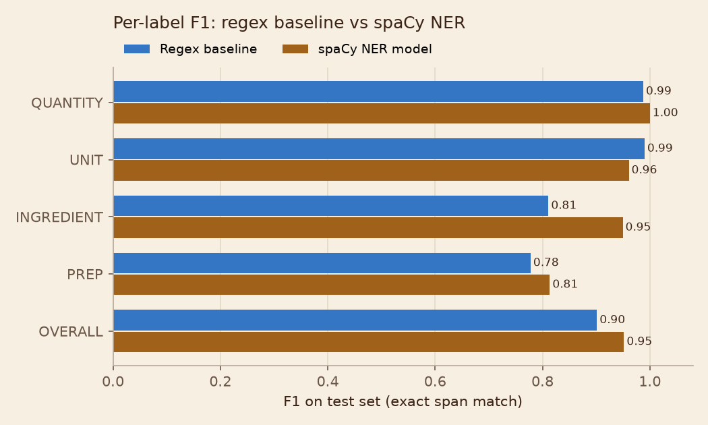

# Results (test set, 82 lines)

| Label | Baseline P | Baseline R | Baseline F1 | Model P | Model R | Model F1 |
|---|---|---|---|---|---|---|
| QUANTITY | 0.976 | 1.000 | 0.988 | 1.000 | 1.000 | 1.000 |
| UNIT | 0.980 | 1.000 | 0.990 | 0.942 | 0.980 | 0.961 |
| INGREDIENT | 0.890 | 0.745 | 0.811 | 0.940 | 0.959 | 0.950 |
| PREP | 0.840 | 0.724 | 0.778 | 0.800 | 0.828 | 0.814 |
| **OVERALL** | 0.933 | 0.872 | 0.901 | 0.943 | 0.961 | 0.952 |

